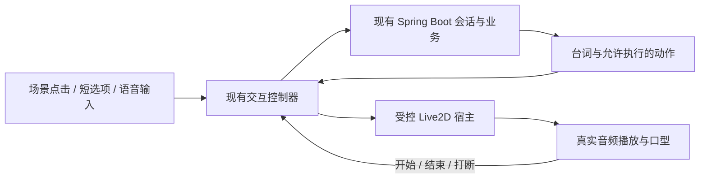

# 声动汉语：统一开发记录

更新：2026-09-28。本文承接前后端界面与数字人互动两个聊天，区分当前实现和建议的下一步。

## 统一入口

- 主聊天：[声动汉语 · 前后端与数字人统一开发](codex://threads/01a0e33d-9532-7503-a765-d4dd2948e470)。后续项目开发在这里继续。
- 历史聊天：[前后端工作交接记录](codex://threads/01a0bf41-3844-7603-bc53-12e4606b1dc6)。已完成交接并停止修改。旧聊天归档后触发工作树清理，现已解除归档，保留历史；后续不通过归档此聊天清理代码。
- 当前代码：`/Users/vinsenz/.codex/worktrees/unified-development/Chinese-Learning`，分支 `codex/unified-development`。旧工作树被应用清理后，已从 `archive-cleanup` 源码快照恢复两边最新代码，并将工作树绑定到主聊天。原有未提交源码已包含在恢复快照中。
- `/Users/vinsenz/Projects/Chinese-Learning` 的 `main` 以及 8092 独立实验页不是当前开发入口。本地启动方式见[根 README](../README.md)，互动协议见[接入说明](interaction/README.md)。

应用没有提供拼接两份聊天历史的工具；本次完成的是上下文、代码入口和后续工作的统一。

本日交接后已重新启动本地前端、后端和测试 SMTP；4195 页面返回 200，并加载录音胶囊、评分动画和互动模块。同源交互接口对未登录请求返回预期的 401；8091、21025、23306、26379 均可连接。这是启动与鉴权冒烟检查，不是外部供应商端到端验证。预览：[当前工作台](http://127.0.0.1:4195/index.html#voice-interaction)。

恢复说明：本地运行配置已从仍运行的后端进程恢复并保持私密；前后端和测试 SMTP 已切到新工作树，MySQL / Redis 原数据卷保留。构建通过。忽略文件不在源码快照中，旧临时截图、日志及音频文件不能视为已恢复。

本次登录检查：已用本地测试 SMTP 完成测试账号注册，并在应用内浏览器通过登录表单正常登录。个人资料和零条测评记录正常读取；数字人画面可加载；互动会话与台词提交成功，页面显示“台词已准备，尚未送达数字人”；收起、展开、停靠下方及放回画面均通过。账号信息仅存于忽略目录 `.local/preview-account.json`。未申请麦克风权限，未调用腾讯评分或外部 AI，也未验证人物受控播报。

## 当前已实现与未完成范围

| 模块 | 当前实现 | 仍需完成或验证 |
| --- | --- | --- |
| 现有工作台 | 原 HTML/CSS/JS 界面、玻璃效果、导航与窄屏布局；保留正文、价格和入口 | 不在本轮新增原有占位业务 |
| 业务后端 | Spring Boot、Redis 登录态、MySQL；登录注册、资料、聊天、评分保存、录音上传与历史已接回 | 真实邮件与供应商链路仍需端到端验证 |
| 朗读练习 | 复用 PCM 的录音波形、计时、停止控件；真实分数的数字过渡；录音失败与迟到回调收尾 | 实际麦克风、腾讯 SOE、FastGPT 联合成功链路尚未完整实测 |
| 数字人入口 | 同源 `avatar-stage.html`：沿用原托管形象 Shizuku 与「可爱城市」背景，接受互动卡的播报与打断，音量驱动口型（2026-11-03 替换原 Light4AI 托管页） | 动作、头发物理未接；素材许可待确认 |
| 交互底座 | 当前账号鉴权，临时交互会话、轮次、取消、旧结果隔离；`AvatarBridge` / `AvatarHost` 协议；`agent.ask` 把场景上下文与最近 6 轮对话交给 OpenAI 兼容接口 | 本地未配置 AI 密钥，仅用模拟接口验证；游戏规则、判分、语音输入未接 |
| 数字人语音 | 服务器默认腾讯云语音合成（TextToVoice）；本机可设 `INTERACTION_TTS_PROVIDER=local` 用 macOS `say` | 尚未用真实密钥实测签名通过 |

录音模块的 `pendingRecorderStart` 保护要保留：现有录音 SDK 共享 Worker，浏览器权限请求未决时不能并发启动第二个录音器。原“听反馈”使用浏览器语音能力，也不等于数字人控制。

既有验证记录来自两个聊天的交接，本次文档整理未重跑：前后端界面侧最近 37 项前端检查通过，较早业务后端 19 项检查通过；交互侧最近 7 项控制器检查通过，较早交互后端 19 项及会话工具 4 项检查通过。它们覆盖不同范围，不能作为整站或供应商全部通过的结论。

## 上线准备（2026-11-03）

已在本机用 Linux 容器模拟服务器验证（nginx 1.20 加载仓库 `nginx.conf`、Java 17 运行新 jar、全新 MySQL 建表）：用局域网 IP 访问可注册、登录、进入工作台，数字人画面与互动卡正常；页面不再依赖 jsdelivr；2.5 MB 上传不再被 nginx 拦截；未配置腾讯语音合成时提示明确，配置错误密钥时腾讯云返回 `AuthFailure.SecretIdNotFound`，说明服务器到腾讯云的请求链路可用。

上线前仍需在服务器上完成：

1. 备案完成前用 IP 访问：部署新版 `nginx.conf`（新增 `listen 80 default_server` 段）并 `nginx -t && nginx -s reload`；安全组放行 80。HTTP 下浏览器禁用麦克风，语音测评无法录音，数字人不受影响。
2. 静态文件：`webdemo1-1/` 全部内容复制到 `/usr/share/nginx/html/`（含 `live2d/`、`js/vendor/`）。
3. 后端：上传新 jar，按 `backend/.env.example` 写 `/home/ubuntu/shengdonghanyu.env`，安装新版 `shengdonghanyu.service` 后 `systemctl daemon-reload && systemctl restart shengdonghanyu`。
4. 数据库：确认已执行 `add_user_profile_fields.sql`、`add_chat_tables.sql`。
5. 腾讯云账号开通「语音合成」并配置密钥；用真实密钥让数字人说一句话，确认签名通过。
6. 注册验证码需要真实 SMTP；或提前为组员建好账号。
7. 建议安全组关闭公网 8088，只经 nginx 访问后端。

## 界面方向：人物、场景、轻量输入共同组成练习

弹窗只是当前容器的选择。建议保持人物为主视角，把题目与操作放进同一个场景，整轮结束时再显示较完整的总结。

| 形式 | 学生直接做什么 | 人物如何回应 | 优先级 |
| --- | --- | --- | --- |
| 底部字幕与短选项 | 看两行字幕，点短回复或开口回答 | 说话、表情、视线与已有动作 | 先做，适合通用底座 |
| 场景物件与热点 | 点书、杯子、商品等物件 | 看向物件，说明或提示 | 下一步添加，适合选词与找物 |
| 桌面拖拽 | 排词卡、将物件放入指定区域 | 对操作给出即时反馈 | 规则明确后添加 |
| 人物触碰 | 点已配置的头部或身体区域 | 表情、动作、重听等 | 作为辅助入口；关键操作仍有可访问按钮 |

场景物件和字幕可以使用现有 DOM/CSS，与 Live2D canvas 叠在同一容器内，不要求把按钮都画进 WebGL。游戏的拖放和判分由业务实现；Live2D 提供模型输入和表现。

## 可以学习的项目与真实能力

以下为 2026-09-28 对官方文档及仓库源码的核验，没有在本机运行这些开源项目。

1. **[Live2D Cubism Web 官方样例](https://github.com/Live2D/CubismWebSamples/blob/develop/Samples/TypeScript/Demo/src/lapplive2dmanager.ts)**：`onTap` 中点击头部切换表情、点击身体播放动作，`onDrag` 将指针位置交给模型。适合学习人物反馈；该拖动不是独立物件的拖放游戏。
2. **[Sentio 的人物与背景层](https://github.com/wan-h/awesome-digital-human-live2d/blob/main/web/app/%28products%29/sentio/components/live2d.tsx)**及[输入模式](https://github.com/wan-h/awesome-digital-human-live2d/blob/main/web/app/%28products%29/sentio/components/chatbot/index.tsx)：背景、Live2D 与聊天控件分别组织。可借鉴沉浸式布局；开源代码的能力不等于当前托管 iframe 已向我们开放接口。
3. **[Open-LLM-VTuber 的布局](https://github.com/Open-LLM-VTuber/Open-LLM-VTuber-Web/blob/main/src/renderer/src/App.tsx)**及[底部字幕](https://github.com/Open-LLM-VTuber/Open-LLM-VTuber-Web/blob/main/src/renderer/src/components/canvas/subtitle.tsx)：人物舞台、可折叠面板和字幕分开，可学习如何减少遮挡。教学选项与游戏判定需要自己实现。

官方能力依据：[HitAreas 命中检测](https://docs.live2d.com/en/cubism-sdk-manual/hitarea/)、[参数操作](https://docs.live2d.com/en/cubism-sdk-manual/parameters/)、[动作事件](https://docs.live2d.com/en/cubism-sdk-manual/motion/)、[WAV 音量口型](https://docs.live2d.com/en/cubism-sdk-tutorials/native-lipsync-from-wav-web/)。

动作、表情、可点区域依赖模型已有资源及配置，SDK 不会自动生成“举手接苹果”等新动作。官方音量口型示例驱动嘴部开合，示例本身不播放声音，也不能据此声称有中文音素级口型。

## 下一步建议：先完成一轮可控的人物互动

沿用现有前后端，将数字人显示端改为可修改的同源宿主，接入现有桥接协议。优先用 Cubism Web 构建小范围 driver，借鉴 Sentio 的场景组织；本阶段无需迁移整个 Next.js / Python 项目或引入游戏引擎。实施前需要确定可使用的模型文件、贴图、动作和表情，不能从“iframe 中看得到人物”推断已拥有资源。

第一轮验收：输入一句台词，人物真实播报并随音频张嘴；可中途打断，声音和嘴部及时停止；切页取消当前轮次；旧回调不复活；只有音频自然结束才推进下一步。保持同一音频播放链路，动作结束不能代替播报结束。

之后再加最小的场景热点和底部选项。教学 Agent 后续负责理解输入、提示和对话，业务代码负责允许的状态变化及判分。用户尚未选定具体游戏，本记录不预设题库或玩法。
